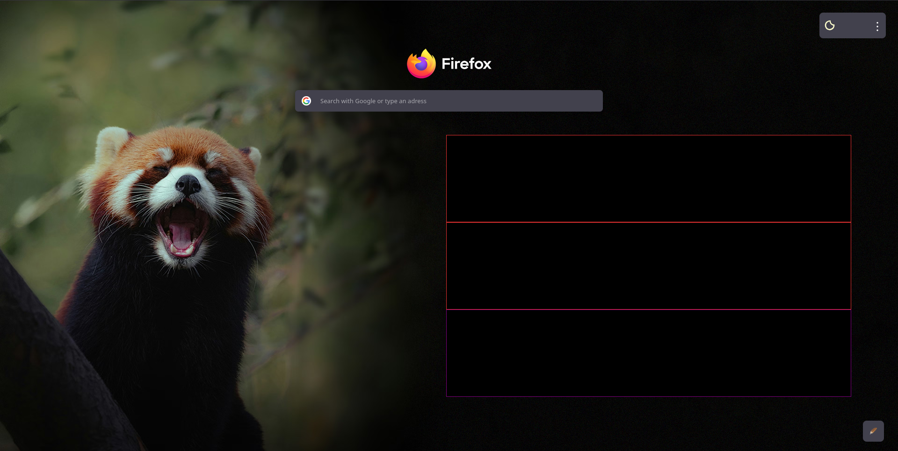

# NamaStream · Live Stream Dashboard

> A web extension that replaces your browser's default new tab with a real-time dashboard of live streams and upcoming schedules. Powered by the YouTube and Twitch APIs.


---



*Template preview (layout may differ between versions)*

---

## Features

- **Live streams panel**: channels currently live on YouTube, with thumbnails, titles, and viewer counts
- **Upcoming streams panel**: Scheduled streams sorted by start time, with localized countdowns
- **Twitch panel**: channels currently live on Twitch
- **Weather widget**: Current conditions, feels-like, humidity and wind speed based on your location; supports manual city search
- **Custom new tab**: Replaces the new tab in Firefox and Chrome with a full-screen dashboard and custom wallpaper support
- **Popup settings**: Pin or disable individual channels, toggle bars, change layout, reposition bars freely, resize bars

### Architecture highlights

- Backend on **Cloudflare Workers** (Hono + JavaScript), with separately cached YouTube endpoints and a Twitch endpoint
- Parallel YouTube requests use separate endpoints to stay within per-request Workers Free limits and improve concurrency for large channel lists
- Data Normalization to reduce CPU Time (~30ms -> ~7ms)
- Integration with 5+ different APIs
- Client-side stream filtering and sorting, reducing server processing
- JS Modularization -> Every feature has its own file

---

## Roadmap

- [x] Scrollable stream bars (v1.1)
- [x] Wallpaper picker with local storage (v1.1)
- [x] Twitch live stream support (v1.21)
- [x] Per-channel enable/disable and pin (v1.21)
- [x] Weather widget with geolocation and city search (v1.3)
- [x] Reposition mode: drag bars freely (v1.3)
- [x] Resizable bars (v1.3)
- [x] Layout options: toggle logo, search bar, individual stream bars (v1.3)
- [x] Twitch channel disable/pin (V1.3.1)
- [x] Wallpaper Site Integration (V1.3.1)
- [x] Vertical Twitch bar layout (v1.3.2)
- [x] Live preview on thumbnail hover (v1.3.3)
- [x] Client startup and asset-loading optimizations (v1.3.4)
- [x] Chrome support (v1.35)
- [x] Configurable hover-preview behavior (v1.35)

## Stacks

| Layer | Tech |
|---|---|
| Extension | HTML · CSS · Vanilla JS |
| Backend | Cloudflare Workers · Hono · JavaScript |
| Cache | Cloudflare KV |
| APIs | YouTube Data API v3 · Twitch API · Wallhaven · Open-Meteo · Nominatim |

---

## Development

### Prerequisites

- [Node.js](https://nodejs.org/) 18+
- [Wrangler CLI](https://developers.cloudflare.com/workers/wrangler/): `npm install -g wrangler`
- A Google Cloud project with YouTube Data API v3 enabled
- A Cloudflare account (free tier)
- A Twitch developer account

### Setup

```bash
git clone https://github.com/komo404/NamaStream.git
cd NamaStream

cd API
npm install

# Store secrets: never committed to the repo
wrangler secret put YOUTUBE_API_KEY
wrangler secret put Client_Id
wrangler secret put Client_Secret
```

### Running locally

```bash
# Start the Worker dev server (the scheduled refresh is disabled)
cd API
npm run dev
```

To load the extension in Firefox:
1. Open `about:debugging`
2. Click **This Firefox** → **Load Temporary Add-on**
3. Select `manifest.json` from the root of this repo

To load the extension in Chrome:
1. Open `chrome://extensions`
2. Enable **Developer mode**
3. Click **Load unpacked** and select the root of this repo

Both browsers use the same `manifest.json` and extension files.

---

## Third-party services

### YouTube Data API
This extension uses the [YouTube Data API v3](https://developers.youtube.com/youtube/v3). By using NamaStream, you agree to the [YouTube Terms of Service](https://www.youtube.com/t/terms).

### Twitch API
This extension uses the [Twitch API](https://dev.twitch.tv/docs/api/). By using NamaStream, you agree to the [Twitch Developer Agreement](https://legal.twitch.com/legal/developer-agreement/).

### Wallpaper and weather services
Wallpaper search uses [Wallhaven](https://wallhaven.cc/). Weather data uses [Open-Meteo](https://open-meteo.com/), and automatic location names use [Nominatim](https://nominatim.org/) from OpenStreetMap. The stream hover preview uses the configured preview proxy shown in `newtab/features/streams/preview.js`.

---

## Documentation

- [API documentation](./API/README.md)
- [Privacy Policy](./PRIVACY.md)
- [Changelog](./CHANGELOG.md)
- [License](./LICENSE)

### Weather icons

The SVGs in `assets/weather/` are copied from Firefox's weather resources and are licensed under the [Mozilla Public License 2.0](https://mozilla.org/MPL/2.0/). Their original license notices are preserved in each file.

---
*NamaStream is an independent project not affiliated with or endorsed by YouTube, Twitch, Google, or OpenStreetMap.*


## Channel setup

- Copy `API/src/channels_example.js` to `API/src/channels_local.js` and export `channelIDs` and `channelIDs2` from that file. The second list is optional; use it when you want to split a large YouTube channel list across both endpoints.
- Add YouTube channels to either list using their channel IDs. The extension calls both endpoints, so leave `channelIDs2` empty when using only the first group.
- Set Twitch usernames in `API/src/twitchService.js`.
- Add your channels to the popup list if you want per-channel enable, disable, and pin controls.
- Deploy your Worker and update the URLs and host permissions